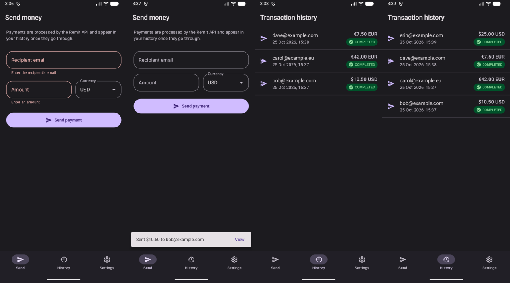
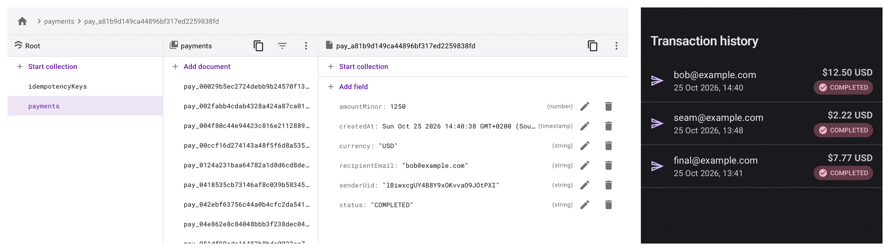
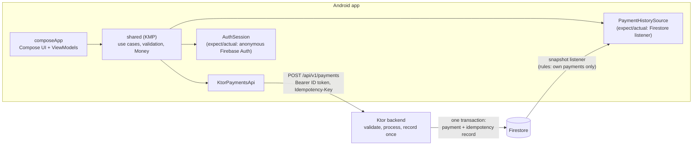

# Remit

A Compose Multiplatform payments app: send money to an email address in USD or EUR, and watch
your transaction history update live from Firestore. A Ktor backend processes each payment
exactly once and records it in Firestore. Built as a take-home challenge on top of
[my own project template](docs/TEMPLATE.md).



[Demo video (82 s)](docs/images/remit-demo.mp4) · [Demo script](docs/DEMO.md)

## What it does

- **Send a payment.** Recipient email, amount, and a USD/EUR picker. The amount field accepts only
  digits and one decimal separator (`.` or `,`). Validation runs on the device
  and again on the server, with the same rules, and every problem is shown next to its field.
  Success shows "Sent $10.50 to bob@example.com" with a link to History; a failure explains
  what happened and offers Retry when retrying can help.
- **Transaction history.** Your payments from Firestore, newest first, each with recipient,
  amount, currency, time, and status. A Firestore snapshot listener keeps the list live while
  the screen is open: a payment recorded anywhere appears without a refresh.
- **Light and dark themes.** Material 3 light and dark colour schemes. The app follows the
  system setting by default, and Settings offers System, Light, or Dark (saved across launches).
  The status and navigation bar icons follow the app's choice, and the screenshot tests render
  every component in both themes.
- **Payments API.** `POST /api/v1/payments` takes
  `{"recipientEmail": String, "amount": Number, "currency": String}`, validates it, processes it
  (a mock processor that approves every valid payment), writes it to Firestore, and returns the
  stored payment. Errors use `{"error", "code", "details"}`. Every call needs a Firebase ID token
  (`Authorization: Bearer`) and an `Idempotency-Key` header; step 9 of the
  [demo script](docs/DEMO.md) has a copy-paste curl that gets a token from the Auth emulator.

## Run it

Requirements: JDK 21+, Android SDK with an emulator, Node 22+, and the Firebase CLI
(`npm install -g firebase-tools`). Everything runs locally against the Firebase Emulator Suite;
no Firebase account, credentials, or `google-services.json` are needed: without
`google-services.json`, the debug app starts Firebase for the emulators itself.

```bash
make emulators            # terminal 1: Firebase Auth + Firestore emulators (UI on http://localhost:4000)
make backend-emulated     # terminal 2: the API on http://localhost:8085 against the emulators
make mobile               # terminal 3: build, install, and launch the Android debug app
```

Then send a payment and open History. Swagger UI is at <http://localhost:8085/swagger>.

The debug app reaches the emulators and the API at `10.0.2.2`, your machine as seen from the
Android emulator (a physical device needs `adb reverse`: see [TROUBLESHOOTING.md](TROUBLESHOOTING.md)).
If History says the emulators aren't answering, start them with `make emulators` and retry.

To use a hosted Firebase project instead, see [Hosted Firebase project](#hosted-firebase-project).

## Firebase

The brief asks for Firestore to store and retrieve the payments, with the Firebase logic in the
shared KMP module behind expect/actual and the Firebase setup in `androidApp`. Both sides use the
real Firebase SDKs: the Firebase Android SDK in the app and the Firebase Admin SDK in the backend.
`make emulators` runs Firebase's own Auth and Firestore emulators, so a fresh clone works without
a Firebase account; a hosted project is a configuration change, not a code change.



| The brief asks for | Where it is |
|---|---|
| Firestore stores the payments | The backend writes each payment to `payments/{id}` in one Firestore transaction with its idempotency record: [`FirestorePaymentStore.kt`](backend/src/main/kotlin/com/asterixorobelix/remit/service/FirestorePaymentStore.kt) |
| History comes from Firestore, in real time | A snapshot listener on the signed-in user's payments, newest first: [`FirestorePaymentHistorySource.kt`](mobile/shared/src/androidMain/kotlin/com/asterixorobelix/remit/shared/data/history/FirestorePaymentHistorySource.kt) |
| Firebase logic in `shared`, expect/actual for the SDK | `expect fun firebaseBackendModule` in [`FirebaseBackend.kt`](mobile/shared/src/commonMain/kotlin/com/asterixorobelix/remit/shared/data/FirebaseBackend.kt); the Android actual binds the Firebase SDK, and iOS and desktop bind "not set up" implementations |
| Firebase setup in `androidApp` | `google-services.json` and the emulator host, in [`build.gradle.kts`](mobile/androidApp/build.gradle.kts) |

Firebase Auth identifies the user as well: the app signs in anonymously
([`FirebaseAuthSession.kt`](mobile/shared/src/androidMain/kotlin/com/asterixorobelix/remit/shared/data/auth/FirebaseAuthSession.kt)),
the backend verifies the ID token on every payment
([`TokenVerifier.kt`](backend/src/main/kotlin/com/asterixorobelix/remit/service/TokenVerifier.kt)),
and [`firestore.rules`](firebase/firestore.rules) let each user read only their own payments and
no client write any (`make test-rules`).

To watch it, keep the Emulator Suite UI open at <http://localhost:4000/firestore> while you send a
payment: a document appears in `payments` (and one in `idempotencyKeys`), and History shows the
payment without a refresh. `make test-backend-emulated` runs the Admin SDK against the same
emulators.

### Hosted Firebase project

The same build runs against a hosted project; `.firebaserc` names it (`remit-payments`). Reviewers
don't need one.

1. In the Firebase console, turn on **Anonymous** under Authentication → Sign-in method.
2. Deploy the security rules and the index History needs:
   `firebase deploy --only firestore:rules,firestore:indexes`.
3. Register the Android apps `com.asterixorobelix.remit` and `com.asterixorobelix.remit.debug`,
   and save their `google-services.json` in `mobile/androidApp/` (gitignored). Debug builds then
   use the project instead of the emulators; remove any `FIREBASE_EMULATOR_HOST` setting.
4. Create a service account key (Project settings → Service accounts), keep it outside the
   repository, and start the backend with it:

   ```bash
   FIREBASE_PROJECT_ID=remit-payments GOOGLE_APPLICATION_CREDENTIALS=/path/to/key.json make backend
   make mobile
   ```

Payments then appear on the Firestore page of the Firebase console. To go back to the emulators,
move `google-services.json` out of `mobile/androidApp/` and rebuild.

## Where this differs from the brief

Each of these is deliberate; the reasons are under [Design decisions](#design-decisions).

- **`POST /api/v1/payments`, not `/payments`.** The API is versioned, and the endpoint requires a
  Firebase ID token and an `Idempotency-Key` header, so a bare
  `curl -d '{...}' localhost:8085/payments` gets a 404 (and the same call on `/api/v1/payments` a
  401). Use the curl in step 9 of the [demo script](docs/DEMO.md).
- **The backend saves the payment to Firestore, not the app.** The brief has the app call the API
  "then save the transaction to Firestore"; here the server writes it in the same transaction
  that records the idempotency key, and the app only reads.
- **`amount` is read as an exact decimal, not a `Double`.** The JSON shape is unchanged (a JSON
  number), but `10.50` is never a floating-point value on either side.
- **The Compose UI lives in `mobile/composeApp`, not `androidApp`.** It is Compose
  Multiplatform, so the same screens run on Android, in the desktop gallery, and in the iOS shell;
  `androidApp` is the Android entry point and Firebase setup.
- **The Cucumber "saved to Firestore" step checks an in-memory Firestore**, so the scenarios run
  in seconds without emulators. The real write is covered by `FirebaseEmulatorTest` (Admin SDK
  against the Firestore emulator), the rules tests, and the Appium test that finds the payment in
  History.

## Tests

| Layer | Command | What it proves | Where |
|---|---|---|---|
| Unit (shared) | `make test-mobile` | Money parsing, validation, idempotency keys, API client status mapping, repository, use cases: 75 tests, 94% line coverage (90% floor) | `mobile/shared/src/commonTest` |
| Unit (app) | `make test-mobile` | ViewModels (Turbine), the History listener stopping when the screen is hidden, the Send form surviving process death, DataStore settings on a real file, the SQLDelight pending-payment store, formatting, retry policy, crash-report redaction, navigation graph: 104 tests; 85% merged line coverage (80% floor). `commonTest` runs on the desktop JVM and as Android host tests | `mobile/composeApp/src/*Test` |
| Unit and route (backend) | `make test-backend` | Validator, service, routes, token verification, config: 62 tests, 83% line coverage (80% floor) | `backend/src/test` |
| Shared validation cases | runs with both of the above | 65 cases in one JSON file that the app and the server must both satisfy | `testdata/payment-validation-cases.json` |
| BDD (Cucumber) | `make test-bdd` | 13 scenarios: payment processed and saved to Firestore (an in-memory fake), invalid input never sent, retry after a timeout pays once, edited details after a failure are a new payment, a payment interrupted by the app closing finished safely after reopening, history newest first, live updates, per-user isolation | `mobile/shared/src/desktopTest/resources/features` |
| Firebase integration | `make test-backend-emulated` | The real Admin SDK against the emulators: ID token verification, the Firestore transaction, ten concurrent requests with one key create one payment | `backend/.../FirebaseEmulatorTest.kt` |
| Security rules | `make test-rules` | Users read only their own payments; clients can never write | `firebase/rules-tests` |
| UI (Appium) | `make test-appium` | On a real emulator: a sent payment appears in History, invalid input shows errors, EUR with a comma decimal | `e2e/` |
| Performance (JMeter) | `make test-perf` | 5 concurrent users creating and replaying payments, with assertions on status, replay header, and latency | `perf/payments.jmx` |

`make check` runs every CI gate (tests, detekt, ktlint, Android Lint, coverage floors, iOS
framework link, template contracts). Appium and JMeter need the local stack running:

```bash
make emulators            # terminal 1
make backend-emulated     # terminal 2
make test-appium          # installs the current debug build, starts Appium (pinned in e2e/appium)
make test-perf            # HTML dashboard in build/perf/report/index.html
```

`make test-appium` needs the debug app on the emulators: with `google-services.json` present, also
set `FIREBASE_EMULATOR_HOST=10.0.2.2` in `mobile/local.properties`, or the app signs in to the real
Firebase project. Prefer an emulator with a window and hardware
GPU. Under host load (emulators, backend, and Gradle daemons together), a headless `-no-window`
`swiftshader` emulator can raise a system "not responding" dialog. That dialog takes focus, so
a test reports that **Skip** was not found. If that happens, dismiss the dialog or restart the
emulator, then rerun.

JMeter on a laptop against the local emulators (5 users, 20 iterations each, 5 s ramp-up;
205 requests in 4 s, 49 req/s overall):

| Request | Samples | Errors | Mean | p95 | p99 | Throughput |
|---|---|---|---|---|---|---|
| Anonymous sign-in (once per user) | 5 | 0 | 16 ms | 48 ms | 48 ms | 1.3 req/s |
| Create payment | 100 | 0 | 9 ms | 18 ms | 82 ms | 24.3 req/s |
| Replay (same key) | 100 | 0 | 8 ms | 13 ms | 17 ms | 24.8 req/s |

These numbers show the plan works and the endpoint has no obvious bottleneck. They say little
about production, where Firestore is a network hop away. To run the same plan against a deployed
API, point both the API and the sign-in at the real services (the default sign-in is the local
Auth emulator, whose tokens a real backend rejects):

```bash
FIREBASE_API_KEY=<Firebase web API key> scripts/perf.sh -Jprotocol=https -Jhost=api.example.com \
  -Jport=443 -JauthProtocol=https -JauthHost=identitytoolkit.googleapis.com -JauthPort=443 \
  -JauthPath=/v1/accounts:signUp
```

The key comes from the environment and travels in the `X-Goog-Api-Key` header, so it never appears
in a URL, the results file, or the JMeter log (which records every `-J` property).

## Architecture



| Module | Holds | Depends on Compose? |
|---|---|---|
| `mobile/shared` | Payment models, `Money`, validation, use cases, Ktor API client, Firebase auth and history (expect/actual), Koin module | No |
| `mobile/composeApp` | Compose Multiplatform UI (Send, History, Settings) and ViewModels; every user-facing string; the app shell from the template with its own data and domain code (settings in DataStore, the HTTP client, the SQLDelight store for the payment in flight) | Yes |
| `mobile/androidApp` | Android entry point (`MainActivity`, `RemitApplication`), build types and `BuildConfig` (`AndroidAppConfig`), R8 rules, the Baseline Profile, Firebase setup (`google-services.json`), test tags for Appium | Yes |
| `mobile/baselineprofile` | Generates the Baseline Profile on an emulator (Macrobenchmark and UI Automator) | No |
| `backend` | Ktor API, server-side validation, Firestore store, token verification, OpenAPI spec | n/a |
| `firebase` | Firestore rules, indexes, rules tests | n/a |

The layers follow the template's clean architecture: screens send events to ViewModels, which
call use cases; use cases depend on a repository interface; the domain has no framework code.
State is a sealed `UiState` in a `StateFlow`; one-off events (snackbars) go through a `Channel`.

### Kotlin Multiplatform and its cross-platform potential

Only Android is implemented, but almost everything except the UI shell and the Firebase SDK
calls is common code. The `shared` module targets Android, iOS (arm64 and simulator), and the
desktop JVM, and CI links the iOS framework whenever iOS-relevant code changes.

- **Shared:** models, money parsing, validation, idempotency handling, the HTTP client and its
  error mapping, the repository, use cases, and dependency injection. The Cucumber suite runs
  on the desktop JVM against exactly this code.
- **expect/actual:** `firebaseBackendModule()` binds the `AuthSession` and `PaymentHistorySource`
  interfaces. Android uses the Firebase SDK; iOS and desktop bind implementations that fail with
  a clear "not set up" error instead of pretending to have data.
- **To ship iOS:** add the Firebase iOS SDK (Swift Package Manager) and write the `iosMain`
  `firebaseBackendModule` with adapters for `AuthSession` and `PaymentHistorySource`, or use a
  KMP Firebase wrapper such as GitLive's.
  Because `shared` has no Compose dependency, an iOS team could also build the screens in
  SwiftUI and call the same use cases.
- **UI:** the Compose screens are already multiplatform and render in the desktop gallery; the
  iOS app shell from the template hosts them in a `UIViewController`.
- **Strings:** every user-facing string is in one shared Compose Multiplatform resource file,
  [`mobile/composeApp/src/commonMain/composeResources/values/strings.xml`](mobile/composeApp/src/commonMain/composeResources/values/strings.xml),
  read on Android, iOS, and desktop through `stringResource(Res.string.…)`. English only for now; a translation is a
  `values-<locale>/strings.xml` beside it. The architecture check fails literal UI text outside
  previews. The only other string file is Android's `res/values/strings.xml`, holding `app_name`
  for the launcher; iOS takes its display name from `app.properties` through the xcconfig.
- **No strings in `shared`:** it returns codes (`ValidationError.EMAIL_INVALID`,
  `PaymentFailure.TIMEOUT`) and `composeApp` maps them to text in
  `presentation/payments/PaymentMessages.kt`, so a SwiftUI app could word them its own way. The
  backend returns the same codes in `details`, so server-side rejections appear in the app's
  wording.

## Android practices

The Android app follows Google's current guidance. The table says where to find each practice,
and the list after it covers the places where the app deliberately does something else.

| Area | What the app does | Where |
|---|---|---|
| Architecture | Layers per the Guide to app architecture: screens send events to ViewModels, which call use cases over a repository interface. State flows down as a sealed `UiState` in a `StateFlow`. | `presentation/`, `shared/.../domain` |
| Lifecycle | Screens collect with `collectAsStateWithLifecycle`. The History Firestore listener uses `WhileSubscribed(5 s)`, so it stops reading when the app is in the background or another tab is open. One-off effects use `CollectEffects`, a `LaunchedEffect` with `repeatOnLifecycle(STARTED)`: a plain `LaunchedEffect` keeps collecting in the background and would show a snackbar nobody sees. | `PaymentHistoryViewModel`, `CollectEffects` |
| Process death | What the user types is kept in `SavedStateHandle`. A payment already sent is written to SQLDelight before the request, so either survives the system ending the app. | `SendPaymentViewModel` |
| Storage | Settings are in Jetpack DataStore, and every read is asynchronous; the old `SharedPreferences` file is migrated. The payment in flight is in SQLDelight. | `data/preferences`, `PendingPayment.sq` |
| Navigation | Compose Navigation with type-safe `@Serializable` routes and a back stack for each tab. | `navigation/` |
| Startup and UI | The Splash Screen API keeps the splash up until the start screen and saved theme are known. The app draws edge to edge, and the bar icons follow the app's theme. Material 3, light and dark. | `MainActivity`, `ui/theme` |
| Strings and accessibility | No literal UI text: every string is in [`strings.xml`](mobile/composeApp/src/commonMain/composeResources/values/strings.xml), shared by Android, iOS, and desktop. Icon buttons have spoken labels (decorative icons are hidden from TalkBack), and each History row reads as one sentence. | `composeResources/`, `PaymentHistoryScreen` |
| Release build | R8 full mode with resource shrinking. The rules keep only code that is reached by reflection, and the release APK is 4.9 MB. A Baseline Profile generated by Macrobenchmark precompiles startup and the main screens. Cleartext traffic is allowed only to the emulator in debug, and no app data goes to cloud backup or device transfer. | `proguard-rules.pro`, `baselineprofile/`, `data_extraction_rules.xml` |
| Build | AGP 9 defaults: the KMP Android library plugin, built-in Kotlin, and the new DSL, with no opt-out flags. Versions are in a version catalog. targetSdk 36, minSdk 24. | `gradle/libs.versions.toml` |
| Checks | Android Lint (warnings are errors, and the baselines are empty), detekt with Compose rules, ktlint, coverage floors, screenshot tests, an instrumented launch test, and Appium. | `make check-mobile` |

Deliberate departures:

- **Koin, not Hilt.** Hilt runs only on Android; Koin works in common code, so iOS and desktop
  share the same dependency graph. `koinViewModel()` still provides the `SavedStateHandle`.
- **One-off effects in a `Channel`, not in UI state.** Google suggests modelling events as
  state. Here, "show this snackbar once" stays out of the state, and the channel buffers effects
  until the screen is visible again.
- **The activity handles configuration changes itself** (`configChanges`, the Compose
  Multiplatform default). Compose redraws for rotation and theme changes without recreating the
  activity, and process death is handled through `SavedStateHandle` as above.

## Third-party services behind interfaces

No screen, ViewModel, use case, or repository calls a vendor SDK. Each service is an interface in
the app's own terms, a thin adapter implements it, and one place chooses the adapter, so a
provider can be swapped without touching the rest of the app. `scripts/check-architecture.sh`
fails the build if a vendor SDK (Firebase, Sentry, PostHog, and others) is imported anywhere else.

| Service | Interface | Firebase adapter today | Chosen in |
|---|---|---|---|
| Crash reports | `CrashLogger` | `CrashlyticsCrashLogger` (logcat without Firebase) | `androidObservabilityProviders` |
| Analytics | `Analytics` | `FirebaseAnalyticsTracker` (logcat without Firebase) | `androidObservabilityProviders` |
| Sign-in and ID token | `AuthSession` | `FirebaseAuthSession` | `firebaseBackendModule` |
| Payment history | `PaymentHistorySource` | `FirestorePaymentHistorySource` | `firebaseBackendModule` |

Moving crash reports to Sentry, for example, means adding a `SentryCrashLogger : CrashLogger`,
returning it from `androidObservabilityProviders`, and swapping the Gradle dependency. Report
redaction (`RedactingCrashLogger`) wraps whichever provider is chosen.

## Design decisions

**Money is never a `Double`.** Amounts are `Money(minorUnits: Long, currency)`. Typed text is
parsed exactly: one `.` or `,` as the decimal separator, no exponents or grouping, and a minus
sign is "must be more than zero". An
amount with more decimals than the currency allows is rejected, not rounded, so "1,000" in USD
is "Use at most two decimal places" rather than $1.00. The API keeps the JSON shape from the
brief (`"amount": 10.50` is a JSON number), but a custom serializer reads and writes the number's
literal text, so no floating-point value is ever involved, and the server converts with
`BigDecimal`. A JavaScript client sending `0.30000000000000004` gets "too many decimals",
not a silently rounded payment.

**Idempotency: every payment is made exactly once.** A payment request can succeed on the server
while its response never reaches the app: the connection drops, the request times out, or the app
is killed mid-send. The app then cannot tell whether the money moved. Retrying blindly can pay
twice; not retrying can tell the user a payment failed when it went through. An idempotency key
removes the guess. The app generates one random key per payment and sends it with every attempt,
and the server stores the key with the payment, so a repeat of that payment returns the one
already made instead of making another. That makes retrying safe, for the app and for the user.

For example: you send $50.00 to bob@example.com, the server records it, and the connection drops
before the response arrives. The app reports the failure and offers Retry. Without the key, Retry
would make a second $50.00 payment. With it, the server answers with the first payment
(`Idempotent-Replayed: true`), the app shows "Sent $50.00 to bob@example.com", and History has one
payment.

How it works:
- *On the device:* `SendPaymentUseCase` keeps one key per payment. A retry after a timeout, or
  a double tap (sends are serialized), reuses it; editing the details or starting a new payment
  after a success gets a new one. Because of the key, the POST can safely be retried
  automatically: once, quickly, with a 10 s timeout, so a stopped or hung backend is reported in
  seconds rather than leaving the button spinning.
- *Across a crash:* the key and the payment are written to SQLDelight before the request goes
  out. If the app is killed mid-send, reopening it shows "Unfinished payment" with the form
  filled in; sending it again reuses the key, so the server returns the original if it already
  processed it. This replaced the template's demo table, so the template's database tooling
  serves a real purpose.
- *On the server:* the payment and an `idempotencyKeys/{uid}_{key}` record are written in one
  Firestore transaction. Written separately, a crash between the two could leave a payment
  without its key (a retry would pay again) or a key without its payment. The same key with the
  same payment returns the original (`Idempotent-Replayed: true`); with a different payment it is
  a 409, because a key reused for other details is a client bug that replaying would hide. Keys
  are scoped to the user, so one user's key never matches another's payment. Concurrent retries
  are safe because Firestore serializes the two transactions, so the second one sees the record.
- *Tested:* the Cucumber scenarios for a retry after a timeout and for a payment interrupted by the
  app closing, the emulator test with ten concurrent requests, the JMeter replay sampler, and
  manual runs on the emulator: a send with the backend stopped and retried after a restart, and
  the app force-stopped after a failed send and reopened (each stored exactly once).

**The backend writes to Firestore, the app only reads.** If the app saved payments itself after
the API call, a crash or a lost connection between the two steps would leave a processed payment
missing from history, and anyone could write fake payments. Here a payment appears in history
only when the server has recorded it, and Firestore rules let users read only their own
documents and never write.

**One set of validation rules on two platforms.** The backend is a separate Gradle build, so it
cannot use the KMP module directly without dragging Android tooling into its Docker build.
Instead both validators run `testdata/payment-validation-cases.json`; the file caught a real
divergence during development. Validation codes are shared too: the server returns
`details: ["EMAIL_INVALID"]`, and the app highlights that field.

**Authentication without a login screen.** The app signs in anonymously with Firebase, so every
install has a stable user id. The backend verifies the ID token and stamps the uid on the payment;
the Firestore rules use the same uid. Upgrading to email or phone sign-in later keeps the same
user (Firebase account linking).

**Failure handling.** Network errors, timeouts, 5xx, and 429 are retryable and keep the form
(a server that cannot verify tokens, for example because Google's signing keys are unreachable,
answers 503, not 401, so it is not mistaken for a bad sign-in);
validation errors map to fields; an expired token is refreshed once automatically; an unexpected
response says to check History before sending again. Malformed history documents are skipped
instead of breaking the list.

## Beyond the brief

- **A maintained template, not a one-off.** I keep a full-stack template for my own apps, and
  Remit is a real instance of it: the first commit is the template (`git diff template-base..main`
  shows only the challenge work), the next removes its demo features, and the rest builds the app.
  See [docs/TEMPLATE.md](docs/TEMPLATE.md).
- **CI/CD from that template.** Path-filtered GitHub Actions for backend, Android, iOS, and
  Fastlane; Semgrep and gitleaks; coverage floors plus 80% coverage on changed lines in pull
  requests; an OpenAPI contract test that fails when a route and the spec disagree; screenshot
  tests; preview builds; nightly device smoke tests; transactional store delivery.
- **Agent guardrails.** `AGENTS.md` files and edit hooks that lint every change and block edits
  to credentials and generated files. This project was built with AI assistance, and the
  guardrails are part of why the result stays consistent.
- **Fail-closed configuration.** Production refuses to start without a Firebase project or with
  emulator hosts set.
- **Security rules with tests**, a Firestore index for the history query, and an exact amount
  format in the OpenAPI spec.

## Production architecture: what I'd change next

- **A relational ledger as the source of truth.** Firestore is enough here because nothing holds
  a balance. Real money movement needs double-entry postings, database-enforced constraints
  (`CHECK (balance >= 0)`, unique idempotency keys), exact `NUMERIC` amounts, and SQL for
  reconciliation. I would record payments in PostgreSQL and publish them to Firestore through a
  transactional outbox, keeping Firestore as the read model the app listens to.
- **A real processor** called between validation and recording, with the same idempotency key so
  the processor deduplicates too, plus `PENDING` and `FAILED` states driven by its webhooks.
- **Limits and abuse controls:** per-user rate limits, daily limits tied to verification level,
  and App Check so only the genuine app can call the API.
- **Paging** for long histories, push notifications for incoming payments, and the iOS actuals.

## Repository guide

| Path | Contents |
|---|---|
| `mobile/shared`, `mobile/composeApp`, `mobile/androidApp`, `mobile/iosApp` | The app (see [mobile/AGENTS.md](mobile/AGENTS.md)) |
| `mobile/composeApp/src/commonMain/composeResources/values/strings.xml` | Every user-facing string, for Android, iOS, and desktop |
| `mobile/baselineprofile` | Baseline Profile generator (`make baseline-profile`) |
| `backend` | The API (see [backend/README.md](backend/README.md)) |
| `firebase`, `firebase.json` | Firestore rules, indexes, rules tests, emulator configuration |
| `testdata` | Validation cases shared by the app and the backend |
| `e2e` | Appium UI tests |
| `perf` | JMeter plan |
| `docs` | [Demo script](docs/DEMO.md), [template overview](docs/TEMPLATE.md), workflow and release guides |

`make help` lists every command. Kotlin 2.3, Compose Multiplatform 1.10, AGP 9.1, Ktor 3.3,
Koin 4.1, DataStore 1.2, Firebase Admin SDK 9; versions live in
[`gradle/libs.versions.toml`](gradle/libs.versions.toml).
